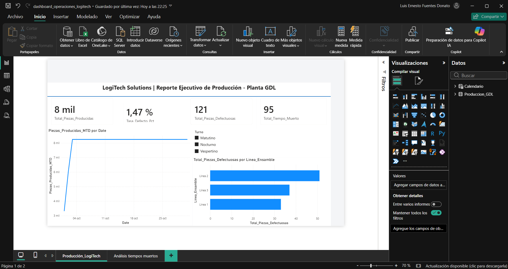
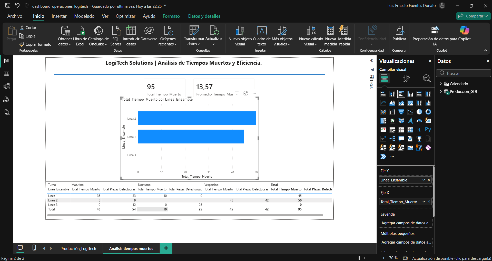

# Tablero ejecutivo de producción y análisis de tiempos muertos en Power BI

Este repositorio contiene una solución integral de Business Intelligence desarrollada para LogiTech Solutions para optimizar el control de operaciones y analizar tiempos muertos en planta.

## Estructura del Proyecto

- **1. PowerQuery_ETL/:** Archivos de datos limpios y consultas estructuradas en Power Query.
- **2. Modelado de datos y tiempo/:** Modelo relacional, esquema en estrella y tablas de calendario (.pbix).
- **README.md:** Guía y documentación del proyecto.

## Visualización del Tablero

### Resumen Ejecutivo de Producción

### Análisis de Tiempos Muertos

## Tecnologías Utilizadas
- **Power Query:** Limpieza y transformación de datos.
- **Modelado de Datos:** Diseño dimensional (Esquema en estrella).
- **DAX:** Medidas calculadas e indicadores clave (KPIs).
- **Power BI Desktop:** Desarrollo de interfaces visuales gerenciales.

